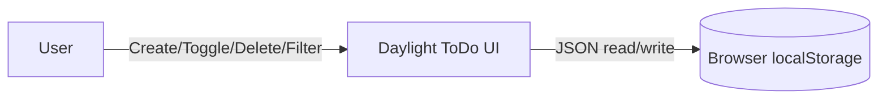
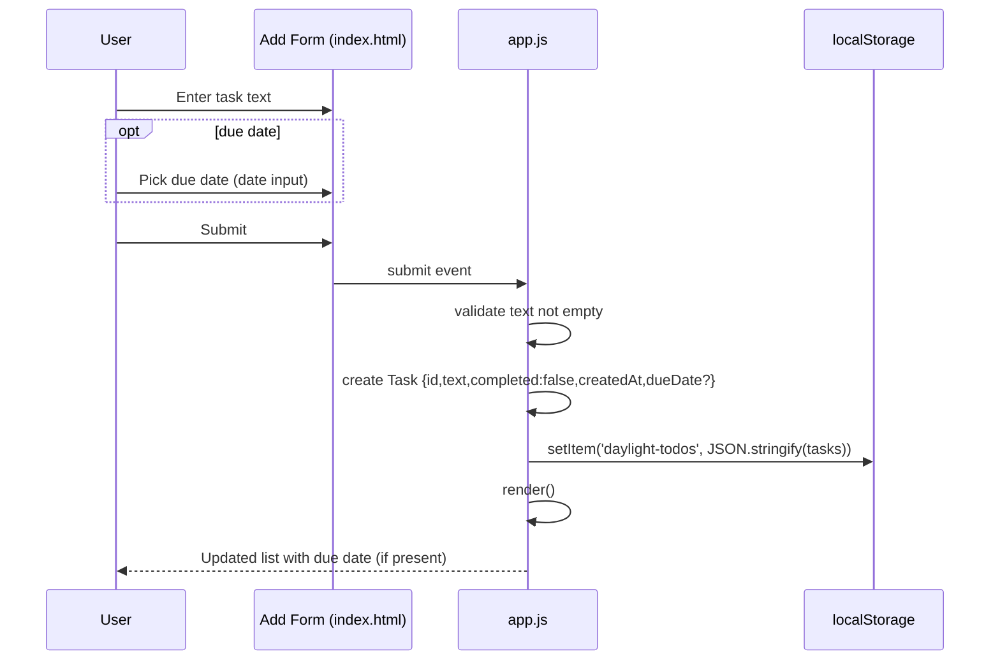
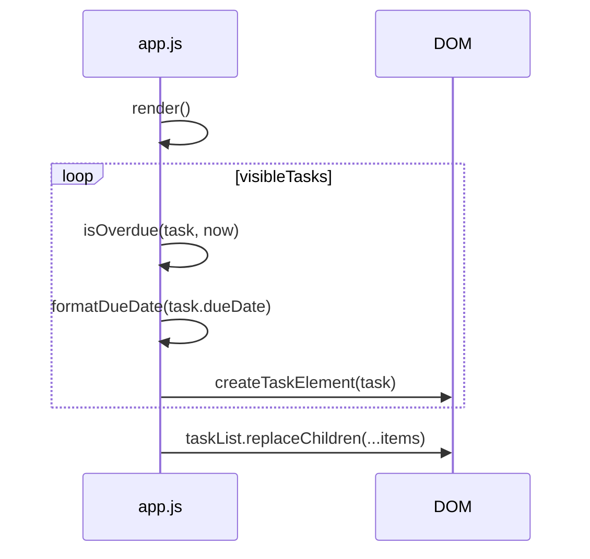

# High-Level Design (HLD) — EPMCDMETST-72039

## 1. System context
Daylight ToDo is a **client-side** ToDo application.

- Users manage tasks in the browser.
- State is stored in memory (`tasks` array) and persisted to `localStorage`.
- There is no backend service.



## 2. Major components
### 2.1 UI (HTML/CSS)
- **Add form**: currently includes `#task-input` and submit button.
  - **Proposed addition**: optional `#due-date-input` (`type="date"`).
- **List toolbar**: counters and filter buttons.
- **Task list**: `<ul id="task-list">` where tasks render into `<li>` elements.

### 2.2 Application logic (`app.js`)
- **State management**
  - `tasks: Task[]` loaded from localStorage.
  - `activeFilter: 'all'|'active'|'completed'`.

- **Persistence**
  - `loadTasks()` reads and validates task objects.
  - `saveAndRender()` writes and triggers UI render.

- **Rendering**
  - `render()` filters tasks and updates DOM counters and list.
  - `createTaskElement(task)` builds a list item.

- **Proposed additions**
  - A small set of pure helper functions for:
    - parsing and validating ISO date-only strings
    - formatting due date to `DD MMM YYYY`
    - computing overdue based on **local calendar date**

## 3. Data model (high-level)
### 3.1 Task (existing + enhancement)
```ts
// Existing in practice (JS object)
type Task = {
  id: string;
  text: string;
  completed: boolean;
  createdAt: number;
  // Proposed (optional)
  dueDate?: string; // ISO date-only 'YYYY-MM-DD'
};
```

### 3.2 Persistence format
- Stored as JSON array under localStorage key: `daylight-todos`.
- Backward compatibility: tasks without `dueDate` remain valid.

## 4. Component interactions
### 4.1 Create task (with/without due date)


### 4.2 Rendering with overdue identification


## 5. Data flow (overdue calculation)
**Input:**
- `task.dueDate` in ISO date-only string
- local current date (`new Date()`)

**Processing:**
- parse `task.dueDate` → local-midnight `Date` (via component parsing)
- compute `YYYYMMDD` numeric keys for due date and today
- overdue if `dueKey < todayKey` AND `!task.completed`

**Output:**
- `li.task-item.is-overdue` + overdue badge in markup

## 6. External dependencies
- Browser APIs:
  - DOM
  - `localStorage`
  - `crypto.randomUUID()` (existing)
  - `Intl.DateTimeFormat` (existing for today label; proposed for due date formatting)

No new third-party libraries.

## 7. High-level UI changes
- Add optional date input to the add form.
- Show due date text (muted) when present.
- Show "Overdue" badge for overdue tasks.

## 8. Error handling & resilience
- Continue to guard `localStorage` reads/writes using existing `try/catch`.
- Validate `dueDate` on load; if invalid, ignore only the due-date field.

## 9. Verification approach (high-level)
- Manual checks mapped to AC-001..AC-009 (see implementation plan Section 9).
- Special focus on:
  - reload persistence
  - due today not overdue
  - completed tasks not overdue
  - older stored tasks with no due date
