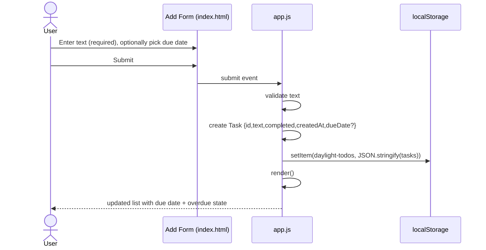

# High-Level Design (HLD) — EPMCDMETST-72039

## 1. System context
Daylight ToDo is a browser-only ToDo list. Users interact via the DOM; the app stores data locally.

**Primary actor:** End user in a web browser.

**External dependencies:**
- Browser DOM APIs
- Browser `localStorage`
- Browser `Intl.DateTimeFormat`

### Context diagram (Mermaid)
```mermaid
flowchart LR
  U[User] -->|Add/Toggle/Delete/Filter| UI[Daylight ToDo UI
(index.html + styles.css)]
  UI <--> JS[Client Logic
(app.js)]
  JS <--> LS[(localStorage
key: daylight-todos)]
  JS --> INTL[Intl.DateTimeFormat]
```

## 2. High-level components and interactions

### 2.1 UI layer (index.html + styles.css)
- Existing: task input (`#task-input`), submit button, list container (`#task-list`), filters.
- **Proposed change:** add an optional `input[type=date]` (proposed id: `#due-date-input`) to the add form.

### 2.2 Client logic (app.js)
- Existing responsibilities:
  - Load tasks from localStorage (defensive parsing)
  - Maintain in-memory `tasks` and `activeFilter`
  - Handle submit/toggle/delete/clear
  - Render UI
- **Proposed additions:**
  - Task model extension with `dueDate?: string`
  - Date helpers:
    - today local ISO string
    - overdue predicate
    - due date formatting helper
  - Conditional DOM additions:
    - due date display
    - overdue badge + overdue CSS class

### 2.3 Persistence (localStorage)
- Continue storing tasks array at `daylight-todos`.
- No migration required. Existing items without `dueDate` remain valid.

## 3. Data flow (key use cases)

### 3.1 Add task (with optional due date)


### 3.2 Render tasks with due dates and overdue marking
```mermaid
flowchart TD
  R[render()] --> F[Filter tasks by activeFilter]
  F --> C[createTaskElement(task)]
  C --> D1{task.dueDate exists?}
  D1 -- No --> DOM1[Render as before]
  D1 -- Yes --> D2[Format due date DD MMM YYYY]
  D2 --> D3{isOverdue?}
  D3 -- No --> DOM2[Render due date metadata]
  D3 -- Yes --> DOM3[Add overdue class + badge + metadata]
```

## 4. Integration design details

### 4.1 Date formatting
- Input: ISO local date string `YYYY-MM-DD` from `<input type="date">`.
- Output: `DD MMM YYYY`.
- Proposed: force an English short month (e.g., `en-GB`) using `Intl.DateTimeFormat` or manual mapping.

### 4.2 Overdue detection
- Compare `dueDate` to `todayIso` where both are `YYYY-MM-DD`.
- Overdue if `dueDate < todayIso` and `completed === false`.

## 5. Error handling (high level)
- Maintain current `try/catch` around `loadTasks()` and `saveAndRender()`.
- If localStorage has malformed tasks, skip them or treat as no due date.
- Rendering must not throw when `dueDate` missing.

## 6. Observability
- Continue using `console.error` for storage load/save failures (existing pattern).

## 7. Non-functional considerations
- Accessibility: overdue badge includes visible text “Overdue”; optional `aria-label` on badge or include in task item label.
- Responsiveness: add date input to form with minimal CSS changes at existing 520px breakpoint.
