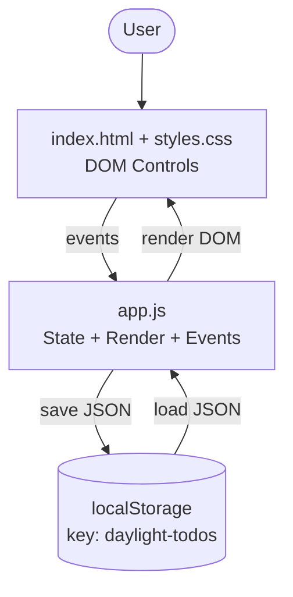

# TODO Application Architecture

## Document Control
- Project: **mm-learning-group-1**
- Repository: **Manoj-A-Anandan/Codemie-Code-Task-Todo**
- Baseline branch: **main**
- Feature branch (docs only): **feature/optional-task-due-dates**
- Feature: **Add Optional Due Dates and Overdue Identification to Tasks**

---

## 1. Purpose
This document describes:
- The **current architecture** of the TODO application.
- The **proposed architecture changes** required to support **optional due dates** and **overdue identification**.

Constraints:
- No backend is introduced.
- No new technologies/frameworks.
- Only minimal, compatible changes to existing structure.

---

## 2. Current Architecture (verified from repository)

### 2.1 High-level structure
The system is a **single-page, client-only** web application.

- UI: `index.html`
- Styling: `styles.css`
- Behavior/state/persistence: `app.js`

### 2.2 Runtime responsibilities (current)
- **State**: `tasks` array in memory.
- **Persistence**: Browser `localStorage` under key `daylight-todos`.
- **Rendering**: `render()` computes filtered tasks and updates the DOM.
- **Event handling**:
  - Create task: form submit on `#add-form`
  - Filter selection: `.filter-button` click updates `activeFilter`
  - Toggle/delete: event delegation on `#task-list` using `button[data-action]`
  - Clear completed: `#clear-completed` click

### 2.3 Data model (current)
Task object persisted in localStorage:
```json
{
  "id": "string",
  "text": "string",
  "completed": false,
  "createdAt": 1710000000000
}
```

`loadTasks()` validates only `id`, `text`, `completed` and filters out invalid records.

---

## 3. Proposed Architecture (feature: due dates)

### 3.1 Summary of changes
No architectural layer changes; the app remains a single-page browser app. Enhancements occur in:
- UI input (HTML + CSS)
- Task model extension
- Render logic extension
- New date/overdue helper logic

### 3.2 Proposed data model extension
Add optional `dueDate` to task:
```json
{
  "id": "string",
  "text": "string",
  "completed": false,
  "createdAt": 1710000000000,
  "dueDate": "YYYY-MM-DD" // optional
}
```

Justification:
- `input[type=date]` produces `YYYY-MM-DD`, which is stable and time-zone-safe for *date-only* use.
- Avoids storing timestamps that can shift date interpretation across timezones.

### 3.3 Proposed overdue calculation
A task is overdue if:
- it has a valid `dueDate`
- it is not completed
- its due date is **strictly earlier** than the **current local calendar date**

This requires date-only comparisons (ignore time-of-day).

### 3.4 Backward compatibility
Existing tasks in localStorage lack `dueDate`. The proposed design:
- Treats missing `dueDate` as “no due date”
- Avoids changing the storage key
- Maintains `loadTasks()` filtering behavior while safely supporting optional `dueDate`

---

## 4. Component View

### 4.1 Current components (files)
- `index.html`: Static structure + controls
- `styles.css`: Styling, responsive adjustments, accessibility helper `.sr-only`
- `app.js`: State management, persistence, and DOM rendering

### 4.2 Proposed component modifications
- `index.html` (MODIFY): Add optional date input in add-task form
- `styles.css` (MODIFY): Style date input, due date display, overdue indicator
- `app.js` (MODIFY):
  - Read due date input
  - Store `dueDate` on task
  - Add helper functions for parsing/formatting/comparing dates
  - Render due date text if present
  - Apply overdue indicator class/element if overdue

No new runtime modules are required.

---

## 5. Interactions & Data Flow

### 5.1 Data flow (create task)
1. User enters task text and optionally selects a date.
2. Submit handler validates text, builds task object (+ optional `dueDate`).
3. `saveAndRender()` persists tasks to localStorage.
4. `render()` regenerates list items.

### 5.2 Data flow (render tasks)
1. Filter tasks based on `activeFilter`.
2. For each visible task, create DOM element via `createTaskElement(task)`.
3. During element creation:
   - If `dueDate` exists, format and display.
   - If overdue predicate is true, apply overdue indicator.

### 5.3 Mermaid — container and flow


---

## 6. External Integrations
- Browser Web APIs:
  - `localStorage`
  - `Intl.DateTimeFormat`
  - `crypto.randomUUID` (when available)

No other external services.

---

## 7. Error Handling & Resilience
Current approach (verified):
- `loadTasks()` uses try/catch; on error, logs and returns `[]`.
- `saveAndRender()` uses try/catch; on error, logs but still calls `render()`.

Proposed approach:
- Preserve existing try/catch pattern.
- Date parsing/formatting must be defensive: invalid/missing `dueDate` must not throw; treat as “no due date” and “not overdue”.

---

## 8. Security Considerations
- No authentication/authorization exists (client-only app).
- Primary considerations:
  - Avoid XSS: continue using `textContent` for user-entered task text.
  - Do not trust localStorage content: continue validating loaded task shape.

No new security surface beyond a new date input.

---

## 9. Architectural Decisions (and justification)
1. **Store due date as date-only string (`YYYY-MM-DD`)**
   - Justification: stable across locales/timezones for date-only comparisons; aligns with HTML date input.

2. **Compute overdue using local calendar date ignoring time-of-day**
   - Justification: matches requirement wording (“current local calendar date”).

3. **Do not introduce new persistence layer**
   - Justification: requirements specify localStorage persistence and repository is front-end only.

4. **Add overdue indicator through CSS class + optional badge element**
   - Justification: minimal DOM changes; preserves event delegation patterns; enables accessible label text if needed.

---

## 10. Unresolved Technical Decisions
- Final overdue visual indicator style (badge vs highlight). Planned resolution: **TASK-001**.
- Whether to restrict selecting past dates in UI (not specified by requirements).
