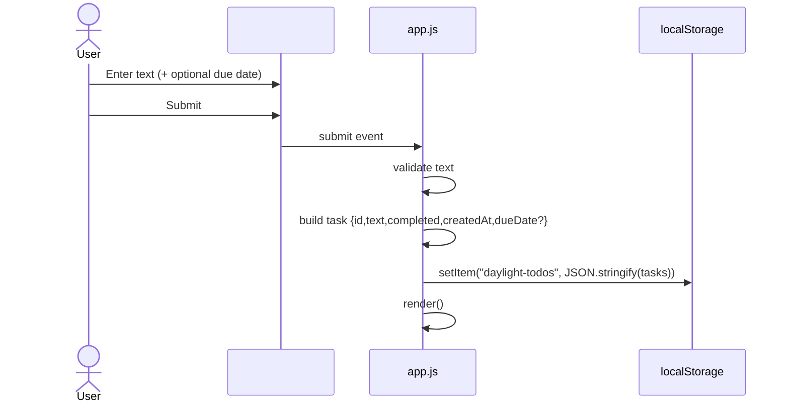
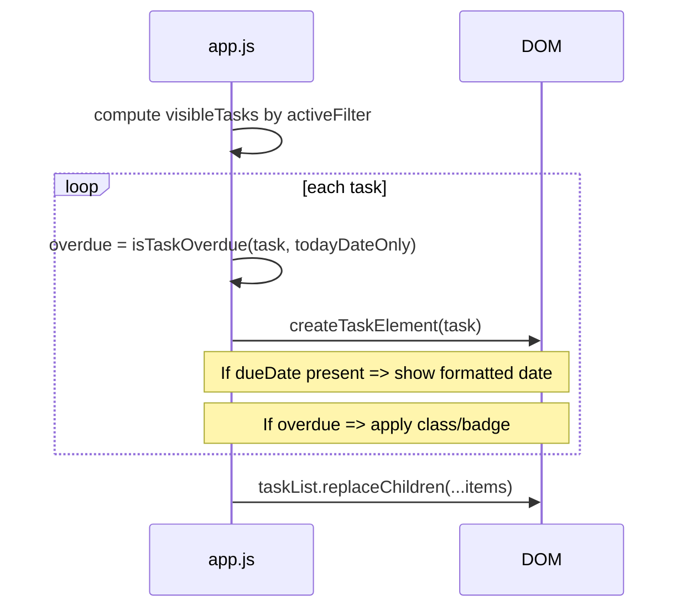

# TODO Application Low-Level Design (LLD)

## Document Control
- Project: **mm-learning-group-1**
- Repository: **Manoj-A-Anandan/Codemie-Code-Task-Todo**
- Baseline: **main**
- Feature: **Add Optional Due Dates and Overdue Identification to Tasks**

---

## 1. Design Goals
- Implement optional due dates with minimal changes to current code structure.
- Preserve backward compatibility with existing stored tasks.
- Ensure overdue calculation uses **local calendar date** semantics.
- Avoid disrupting existing event delegation and accessibility behavior.

---

## 2. Current Code Units (verified)
From `app.js` (main):
- DOM refs: `taskForm`, `taskInput`, `taskList`, etc.
- State: `tasks`, `activeFilter`
- Persistence:
  - `STORAGE_KEY = "daylight-todos"`
  - `loadTasks()`, `saveAndRender()`
- Rendering:
  - `render()`
  - `createTaskElement(task)` creates `<li data-task-id>` and buttons with `data-action`

No classes/modules; everything in file scope.

---

## 3. Proposed Data Model Changes

### 3.1 Task object
**Current (verified)**: `id`, `text`, `completed`, `createdAt`

**Proposed addition**: `dueDate?: string`
- Format: **`YYYY-MM-DD`** (from `<input type="date">`)
- Optional: missing/empty means no due date

Justification:
- Keeps persistence simple and stable.
- Supports local date comparisons without storing timestamps.

---

## 4. Detailed Changes by File

## 4.1 `index.html` (MODIFY)

### 4.1.1 Add optional due date input
- Location: inside the existing form `#add-form`.
- Proposed control:
  - `<input type="date" id="due-date-input" ...>` (exact id is a proposal; must be implemented consistently in JS).
  - Provide accessible label:
    - Preferred: visible label OR `aria-label="Due date (optional)"`.

Constraints:
- Must not change existing IDs used by JS (`#task-input`, `#add-form`).
- Must not add nested buttons that could interfere with event delegation.

### 4.1.2 UX behavior
- Due date is optional (BR-001). Submitting without a date must work (FR-003).

---

## 4.2 `styles.css` (MODIFY)

### 4.2.1 Add form layout updates
- The `.add-form` currently assumes a single text input + add button.
- Proposed: style the new date input so:
  - It does not break the flex layout.
  - On mobile (<=520px), it remains readable and tappable.

### 4.2.2 Due date display styles
Add styles for a due date label element.
- Proposed class names (must be implemented in JS):
  - `.task-meta` (container) or `.task-due-date`

### 4.2.3 Overdue indicator styles
Add a class (e.g., `.is-overdue`) applied to the `.task-item`.
- Possible implementations (final decision in TASK-001):
  - left border highlight + badge text “Overdue”
  - badge only

Accessibility:
- Avoid relying solely on color where feasible; prefer a text badge.

---

## 4.3 `app.js` (MODIFY)

### 4.3.1 DOM references
Add a query selector for the due date input.
- Proposed:
  - `const dueDateInput = document.querySelector("#due-date-input");`

This is a **proposed** id; implementation must match HTML.

### 4.3.2 Task creation (submit handler)
Current flow (verified):
- trim text; if empty focus + return
- create task with `id`, `text`, `completed`, `createdAt`
- reset input and call `saveAndRender()`

Proposed modifications:
- Read `dueDateInput.value`.
  - If value is empty string, do not set `dueDate`.
  - If value matches `YYYY-MM-DD`, set `dueDate`.
- Reset date input after successful add (consistent UX).

Pseudo-diff (illustrative only):
```js
const dueDate = dueDateInput?.value?.trim();
const task = { id: createId(), text, completed: false, createdAt: Date.now() };
if (dueDate) task.dueDate = dueDate;
```

### 4.3.3 Date helpers (new functions in `app.js`)
Add small helper functions (names are proposals; keep file-scope functions consistent with current style):

#### `parseISODateOnly(yyyyMmDd)`
Purpose:
- Convert `YYYY-MM-DD` into a local `Date` at local midnight without timezone shifting.

Proposed behavior:
- Validate with regex `/^\d{4}-\d{2}-\d{2}$/`.
- Split into y,m,d and return `new Date(y, m-1, d)`.
- Return `null` if invalid.

#### `getLocalTodayDateOnly()`
Purpose:
- Return a `Date` representing local calendar day at midnight.

Proposed behavior:
- `const now = new Date(); return new Date(now.getFullYear(), now.getMonth(), now.getDate());`

#### `formatDueDate(yyyyMmDd)`
Purpose:
- Display due date as **DD MMM YYYY** (FR-004).

Proposed behavior:
- Parse with `parseISODateOnly`.
- Use `Intl.DateTimeFormat(undefined, { day: '2-digit', month: 'short', year: 'numeric' })`.
- Return empty string if invalid.

#### `isTaskOverdue(task, todayDateOnly)`
Purpose:
- Encapsulate overdue rule (FR-005/006/007).

Proposed behavior:
- If `task.completed` return false.
- If no dueDate or invalid parse return false.
- Compare parsed due date to todayDateOnly using `.getTime()`.
- Overdue if `dueDateTime < todayTime`.

### 4.3.4 Rendering changes (`createTaskElement(task)`)
Current (verified):
- Creates `.task-item` with optional `.is-completed`
- Adds toggle button, text span, delete button

Proposed modifications:
1. Compute overdue flag using helper.
2. Add class `is-overdue` when overdue.
3. If `task.dueDate` is present and valid, add a due-date element.

DOM structure proposal (must preserve existing buttons):
```html
<li class="task-item ..." data-task-id="...">
  <button class="task-toggle" data-action="toggle">...</button>
  <div class="task-content">
    <span class="task-text">...</span>
    <span class="task-due-date">12 Nov 2026</span>
  </div>
  <button class="delete-button" data-action="delete">×</button>
</li>
```

Notes:
- Adding a wrapper (`.task-content`) is a **proposed** DOM change; if implemented, CSS must be updated accordingly.
- Ensure due date element is not a button and does not contain `data-action`.

### 4.3.5 Persistence / load compatibility (`loadTasks()`)
Current (verified):
- Parses localStorage and filters tasks requiring `id` string, `text` string, `completed` boolean.

Proposed approach:
- Keep the same validation.
- Do not require `dueDate`.
- Do not crash on tasks where `dueDate` is malformed; rendering handles it.

Optional (only if needed):
- Add a lightweight `typeof task.dueDate === 'string'` check before using it, but avoid filtering tasks out solely because dueDate is invalid (to prevent data loss).

---

## 5. Sequence Diagrams

### 5.1 Add task (with optional due date)


### 5.2 Render list with overdue calculation


---

## 6. Validation Rules (LLD)
- Task text: required, trimmed (existing)
- Due date: optional
  - If present, must match `YYYY-MM-DD` (from date input). If malformed, treat as absent for overdue and display.

---

## 7. Error Handling
- Keep existing try/catch around localStorage operations.
- Date helpers must not throw for invalid input.
- Rendering must remain stable even for unexpected task shapes loaded from localStorage.

---

## 8. Security Considerations
- Continue using `textContent` to render task text.
- Do not insert due date via `innerHTML`.

---

## 9. Testing Hooks (for TASK-008 / TASK-009)
Manual verification points:
- Tasks with due date show formatted label.
- Overdue class appears only for incomplete tasks with past due date.
- Due today not overdue.
- Completed tasks never overdue.
- Reload persists due date.
- Filters/toggle/delete/clear completed unaffected.
